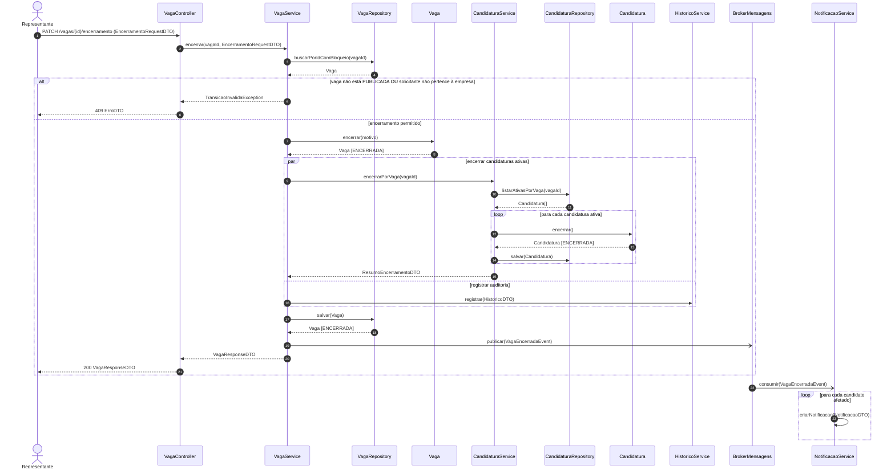
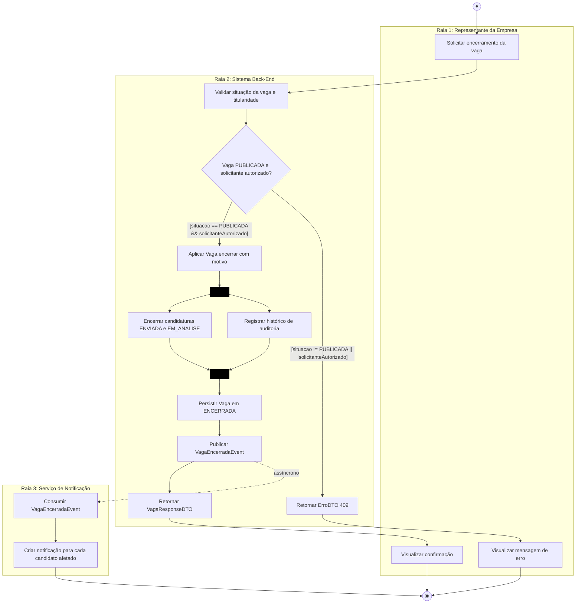
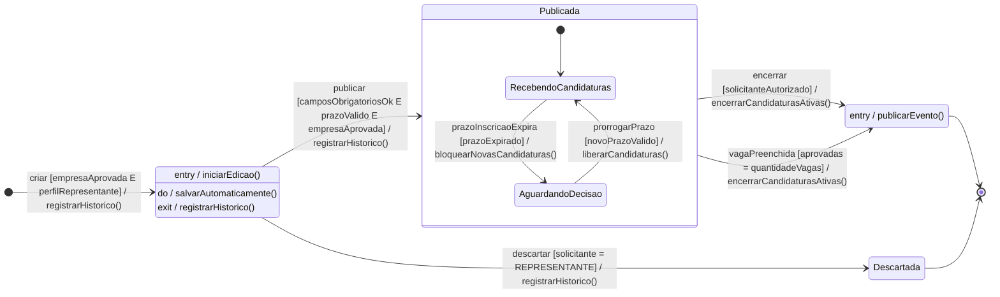

# APS 2 — Dossiê de Arquitetura Viva: Gestão de Vagas

**Unidade Curricular:** Modelagem de Software
**Curso:** Engenharia de Software (4º Período, UniSenai)
**Docente:** Sidney L. da Silva
**Aluno(a):** NOME SOBRENOME
**Projeto da equipe:** Plataforma web que conecta alunos da UniSenai a vagas de empresas parceiras

---

## 1. Funcionalidade crítica escolhida

**Encerramento de vaga com encerramento em cascata das candidaturas ativas.**

Uma vaga percorre o ciclo `Rascunho → Publicada → Encerrada` (ou `Rascunho → Descartada`). Quando o representante da empresa encerra uma vaga publicada, o sistema precisa, de forma consistente:

1. validar que a vaga está `PUBLICADA` e que o solicitante pertence à empresa dona da vaga;
2. encerrar todas as candidaturas ativas (`ENVIADA` e `EM_ANALISE`);
3. registrar a auditoria da transição;
4. publicar o evento `VagaEncerradaEvent` para que os candidatos afetados sejam notificados.

### Por que é crítica

A regra liga **dois ciclos de vida** (Vaga e Candidatura). Se ela falhar, surgem candidaturas em análise para uma vaga já encerrada, o que gera inconsistência de dados e frustração para o aluno.

**Invariante de negócio:** uma vaga `ENCERRADA` nunca possui candidaturas ativas.

### Regras de negócio

| # | Regra |
|---|---|
| RN1 | Somente vagas `PUBLICADA` podem ser encerradas. |
| RN2 | Somente o representante da empresa dona da vaga pode encerrá-la. |
| RN3 | Ao encerrar, toda candidatura `ENVIADA` ou `EM_ANALISE` da vaga passa para `ENCERRADA`. |
| RN4 | Toda transição de estado gera um registro de histórico (quem, quando, de qual estado para qual). |
| RN5 | Os candidatos afetados são notificados de forma assíncrona. |

---

## 2. Estrutura do repositório

```text
aps2-nome-sobrenome/
├── docs/
│   ├── architecture/
│   │   ├── workspace.puml     <- C4 Nível 3 (C4-PlantUML)
│   │   ├── workspace.png      <- imagem renderizada do C4
│   │   └── adr-0001.md        <- Registro de Decisão Arquitetural
│   └── diagrams/
│       ├── sequencia.mmd      <- Diagrama de Sequência (Mermaid)
│       ├── atividades.mmd     <- Diagrama de Atividades (Mermaid)
│       └── estados.mmd        <- Diagrama de Estados (Mermaid)
└── README.md
```

---

## 3. Artefato 1: Diagrama de Sequência

Código-fonte: [`docs/diagrams/sequencia.mmd`](docs/diagrams/sequencia.mmd)



**Notação aplicada**

- `->>` chamada síncrona bloqueante; `-)` chamada assíncrona (mensageria).
- Fragmentos combinados: `alt/else` (tratamento de exceção), `par/and` (paralelismo) e `loop` (iteração).
- Retornos tipados com DTOs: `EncerramentoRequestDTO`, `ResumoEncerramentoDTO`, `HistoricoDTO`, `VagaResponseDTO`, `ErroDTO`, `NotificacaoDTO`.

**Regra de consistência:** toda mensagem enviada a uma linha de vida corresponde a uma operação pública da classe de destino.

| Classe | Operações públicas |
|---|---|
| VagaController | `encerrar(vagaId, EncerramentoRequestDTO)` |
| VagaService | `encerrar(vagaId, EncerramentoRequestDTO)` |
| VagaRepository | `buscarPorIdComBloqueio(vagaId)`, `salvar(Vaga)` |
| Vaga | `encerrar(motivo)` |
| CandidaturaService | `encerrarPorVaga(vagaId)` |
| CandidaturaRepository | `listarAtivasPorVaga(vagaId)`, `salvar(Candidatura)` |
| Candidatura | `encerrar()` |
| HistoricoService | `registrar(HistoricoDTO)` |
| BrokerMensagens | `publicar(evento)` |
| NotificacaoService | `consumir(VagaEncerradaEvent)`, `criarNotificacao(NotificacaoDTO)` |

---

## 4. Artefato 2: Diagrama de Atividades com Raias

Código-fonte: [`docs/diagrams/atividades.mmd`](docs/diagrams/atividades.mmd)



**Notação aplicada**

- **3 raias:** Representante da Empresa, Sistema Back-End e Serviço de Notificação.
- **Guardas mutuamente exclusivas** no nó de decisão: `[situacao == PUBLICADA && solicitanteAutorizado]` e sua negação.
- **Fork/Join:** as barras pretas dividem o fluxo em dois ramos paralelos (encerrar candidaturas e registrar auditoria) e os sincronizam antes de persistir a vaga.
- A seta tracejada representa a mensagem assíncrona ao serviço de notificação.

---

## 5. Artefato 3: Diagrama de Transição de Estados

Código-fonte: [`docs/diagrams/estados.mmd`](docs/diagrams/estados.mmd)



**Notação aplicada**

- Estado inicial `[*]`, subestados (`RecebendoCandidaturas`, `AguardandoDecisao` dentro de `Publicada`) e dois estados terminais (`Encerrada`, `Descartada`).
- Transições no formato formal `Gatilho [CondiçãoDeGuarda] / AçãoDeEfeito()`.
- Ações internas `entry /`, `do /` e `exit /` nos estados `Rascunho` e `Encerrada`.

**Proteção contra estados inválidos:** `Vaga.encerrar()` lança `TransicaoInvalidaException` quando a situação atual não é `PUBLICADA`. Por isso não existem transições como `Encerrada → Publicada` ou `Rascunho → Encerrada`. A ação `encerrarCandidaturasAtivas()` leva as candidaturas `ENVIADA` e `EM_ANALISE` para `ENCERRADA`.

---

## 6. Artefato 4: Visão Arquitetural C4 (Nível 3, Componentes)

Código-fonte: [`docs/architecture/workspace.puml`](docs/architecture/workspace.puml) (C4-PlantUML)


**Tecnologias e protocolos explicitados nos conectores**

| Conexão | Tecnologia / protocolo |
|---|---|
| SPA → VagaController | REST/JSON sobre HTTPS (React → Express) |
| Serviços e repositórios → PostgreSQL 16 | SQL/TCP (`node-postgres`) |
| BrokerMensagens → RabbitMQ | AMQP 0-9-1 (`amqplib`) |
| RabbitMQ → Serviço de Notificação | AMQP 0-9-1 |

---

## 7. Artefato 5: Registro de Decisão Arquitetural

[**ADR 0001 — Encerramento de vaga e candidaturas em transação única**](docs/architecture/adr-0001.md) (Status: Proposto)

Resumo: o encerramento da vaga, o encerramento das candidaturas ativas e o registro de auditoria ocorrem em uma única transação no PostgreSQL 16, com bloqueio pessimista da vaga (`SELECT ... FOR UPDATE`). O evento `VagaEncerradaEvent` só é publicado após o commit.

---

## 8. Consistência entre os modelos

| Elemento | Sequência | Atividades | Estados | C4 |
|---|---|---|---|---|
| Validação (RN1, RN2) | `alt` com `TransicaoInvalidaException` | Decisão com guardas exclusivas | Guarda `[solicitanteAutorizado]` na transição `encerrar` | `VagaService` |
| Encerramento em cascata (RN3) | `CandidaturaService.encerrarPorVaga` | Ramo paralelo "Encerrar candidaturas" | Efeito `encerrarCandidaturasAtivas()` | `CandidaturaService`, `CandidaturaRepository` |
| Auditoria (RN4) | `HistoricoService.registrar` | Ramo paralelo "Registrar histórico" | Efeito `registrarHistorico()` | `HistoricoService` |
| Notificação assíncrona (RN5) | `-)` para `BrokerMensagens` e `NotificacaoService` | Raia 3 com seta tracejada | `entry / publicarEvento()` em `Encerrada` | `BrokerMensagens`, RabbitMQ, worker |
| Estado final da vaga | `Vaga [ENCERRADA]` | "Persistir Vaga em ENCERRADA" | Estado terminal `Encerrada` | PostgreSQL 16 |

---

## 9. Como renderizar os diagramas

- **Mermaid (`.mmd`):** no GitHub os blocos acima aparecem renderizados neste README. Localmente, use a extensão *Mermaid Preview* no VS Code ou cole o código em [mermaid.live](https://mermaid.live).
- **C4-PlantUML (`.puml`):** cole o código em [plantuml.com/plantuml](https://www.plantuml.com/plantuml), exporte o PNG e salve como `docs/architecture/workspace.png`.

---

## 10. Autoria

Trabalho individual, desenvolvido com versionamento contínuo no Git. O histórico de commits registra a evolução de cada artefato.